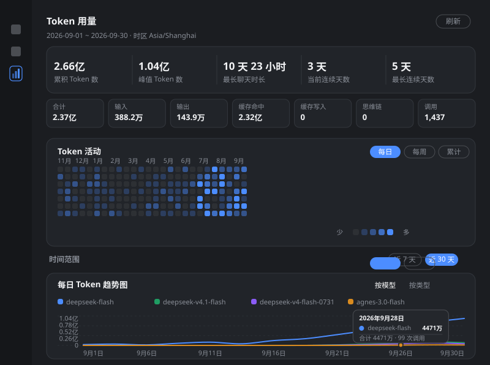

# dsh-plugin-usage-stats

每天用了多少 token、都是什么 token —— 一个 DSH Web 插件：

- **Host 半**（`lib/index.js`）把每次模型调用的 token 计数折叠成「按天 + 按 token 类型」的聚合，并通过一个同源 JSON 路由提供出去。
- **Client 半**（`lib/client.js`）在侧边栏加一个图表图标，点开后是完整的统计面板。



## 面板能看到什么

复刻常见用量看板的版式，从上到下四块：

1. **顶部统计条**（全部时间）：`累积 Token 数` / `峰值 Token 数`（单日最高）/ `最长聊天时长`（单个会话首末事件跨度）/ `当前连续天数` / `最长连续天数`。
2. **Token 活动热力图**：最近 53 周、每天一个方格，三种口径可切 —— `每日`（当天用量深浅）、`每周`（一周一格）、`累计`（到该日的累计量）；悬停显示「日期 · tokens · 调用次数」。
3. **时间范围**：`近 7 天` / `近 30 天`，默认「近 30 天」——一打开就是有内容的曲线；右上角「刷新」立即重取（面板本身每 15 秒自动刷新一次）。
4. **每日 Token 趋势图**：平滑折线，可切 `按模型`（每条线一个 provider/model，最多 6 条，其余合并为「其他」）或 `按类型`（输入 / 输出 / 缓存命中 / 缓存写入 / 思维链）。**鼠标移到图上任意一天**会出现竖向参考线、当天各条线上的点，以及一个浮层：日期 / 每条线的当天数值 / 当天合计与调用次数（`该日无调用` 表示那天没有调用）。

统计条下面还有一行灰色小字，给出**所选区间**的数值：合计、输入、输出、缓存命中、缓存写入、思维链、调用次数。

### 数字单位

面板上所有 token 数字都用中文单位，最多 4 位有效数字，不会出现一长串数字：

| 量级 | 显示 | 例子 |
| --- | --- | --- |
| ≥ 1 亿 | `亿`，2 位小数 | `2.66亿`、`1.04亿` |
| ≥ 1 万 | `万`，按量级取 0～2 位小数 | `1260万`、`810.5万`、`388.2万` |
| < 1 万 | 原样（带千分位） | `4,140` |

折线图的 Y 轴整条轴共用**同一个单位**（不会一半 `万` 一半 `亿`）。顶部统计条、灰色小字、图例、热力图悬停也都走这套格式；**把鼠标停在任意一个数字上仍能看到精确值**（例如 `97,593,756 tokens`）。

没有每日明细表（这是刻意去掉的）。

### 布局

内容整体限制在 **1120px** 宽并居中，窗口拉满 / 全屏时两边留白，折线不会被横向拉长；热力图网格按自身宽度在其卡片内居中，所以右半边不会出现一块突兀的空白。

侧边栏图标位于「任务 / 定时任务」之后（`order: 20`），悬停提示为「Token 用量」。

## token 口径（重要）

数据取自持久化的 `assistant/message` 会话事件，其 `data.usage` 是 **harness 的 `TokenUsage`**，各类计数是**互不重叠**的：

| 字段 | 含义 | 是否计入「合计」 |
| --- | --- | --- |
| `inputTokens` | 未命中缓存的输入 | 是 |
| `outputTokens` | 输出（DeepSeek 的 `completion_tokens`，**已包含思维链**） | 是 |
| `cacheReadTokens` | 缓存命中的输入（DeepSeek 的 `prompt_cache_hit_tokens`） | 是 |
| `cacheWriteTokens` | 缓存写入 | 是 |
| `reasoningTokens` | 思维链，是 `outputTokens` 的**子集** | 否（仅展示） |

因此面板里的 `合计 = 输入 + 输出 + 缓存命中 + 缓存写入`，与计费口径一致；「思维链」单独展示且标注「包含在输出内」，不会重复计数。

- 按天分组使用**本机时区**的日历日（面板标题里会显示实际时区，例如 `Asia/Shanghai`）。
- 按模型归因使用会话日志里的 `request/context` 事件（记录 provider/model 路由）；没有该事件的调用不计入模型表，但仍计入总量。
- 实际运行中 `cacheWriteTokens` 基本不出现（0），`reasoningTokens` 只在少数历史日志里出现，所以这两列大多是 0，属正常。

## 数据接口

```
GET /usage-stats/data?days=30      # days 默认 30，上限 400；0 / 负数 / 非数字一律回落 30。面板用 7 / 30
```

返回结构（节选）：

```json
{
  "ready": true,
  "timeZone": "Asia/Shanghai",
  "range": { "days": 30, "from": "2026-09-01", "to": "2026-09-30" },
  "kinds": ["input", "output", "cacheRead", "cacheWrite", "reasoning"],
  "days": [{ "date": "2026-09-30", "input": 528846, "output": 120595,
             "cacheRead": 17369472, "cacheWrite": 0, "reasoning": 0,
             "total": 18018913, "calls": 182, "sessions": 5 }],
  "totals": { "...": "同上，窗口内汇总" },
  "series": [{ "provider": "rhy", "model": "deepseek-flash", "total": 143789349,
               "values": [0, 120, 3400, "..."] }],
  "models": [{ "provider": "rhy", "model": "deepseek-flash", "total": 143789349, "calls": 960 }],
  "activity": [{ "date": "2026-09-30", "total": 18018913, "calls": 182 }],
  "stats": {
    "cumulative": 199201197,
    "peak": { "date": "2026-09-30", "total": 18018913 },
    "longestSessionMs": 40860000,
    "streak": { "current": 3, "longest": 5 },
    "sessions": 59
  },
  "horizon": { "first": "2026-08-14", "last": "2026-09-30", "days": 17 },
  "folded": { "usageEvents": 1683, "sessions": 63 }
}
```

- `days` / `totals`：所选区间的按天与汇总数据（面板的灰字与「按类型」折线用它）。
- `series`：所选区间内**按天按模型**的用量，按窗口内总量降序，最多 6 条，尾部的路由合并成一条 `其他`（「按模型」折线用它）。
- `activity`：最近 53 周、每天一条，供热力图使用（与所选区间无关）。
- `stats`：全部时间的累积量、峰值日、最长会话跨度、连续天数。
- `models`：全部时间的按模型汇总（保留给其他消费方，面板不再渲染）。

`ready: false` 表示启动时的历史扫描还没跑完，返回的是已折叠的部分数据，面板会显示「历史日志仍在统计中」。

该路由直接注册在 `ctx.webServer` 上（不经过 `/api`），因此自带一道与平台同源的信任栅栏：只接受**回环 Host**（`127.0.0.0/8` 字面量、`localhost`、`[::1]`），拒绝 `sec-fetch-site: cross-site`，并且当请求带 `Origin` 时要求它与 Host 同源。`127.` 开头的**域名**（如 `127.evil.test`、`127.0.0.1.nip.io`）不算回环，会被拒。这是信任栅栏而不是身份认证 —— 它挡浏览器跨站读取，不挡本机进程。

## 安装与卸载

已经安装在本机 `desktop` profile 里。重装或装到别的 profile：

```powershell
# 在 DSH 里让 Agent 调用 plugin_manager：action=install_bundle, target=D:\workspace\dsh-plugin
# 或等价地使用 CLI：
dsh plugin --profile desktop add D:\workspace\dsh-plugin
```

卸载：

```powershell
dsh plugin --profile desktop remove dsh-plugin-usage-stats
# 或 plugin_manager: action=remove_bundle, target=dsh-plugin-usage-stats
```

## 结构与实现要点

```
lib/index.js        Host 半：聚合 + JSON 路由（无第三方依赖）
lib/client.js       浏览器半：手写的 CJS 工厂包（只 require("react")）
cordis.patch.yml    组合包 patch：一行 insert，行名 = 包名
test/               三个 Node 测试（见下）
_research/          构建本插件时的调研证据（DSH 契约、会话日志格式、启动图）
```

- 包同时声明 `dsh.bundle`（Host 行）与 `dsh.client`（`platform: "web"`），一个包名同时作为 loader 行名、客户端图行 id、`__ModuleLoader__.load` 的 id（三者必须一致）。
- 浏览器半的输出格式是 shell 的模块表契约：`window.__ModuleLoader__.load({ id, factory })`，`factory` 内是 CJS；`require("react")` 由 shell 的冻结模块表应答。bundler 只需保持这个 banner/footer 形状。
- 客户端两个座位都用 `ctx.slots.inject(...)` 注册：`sidebar.panellist`（列表项，`id: "usage-stats"`）决定侧边栏按钮，`main`（键控，`key: "usage-stats"`）决定主面板内容 —— 这是 0.2.0-rc.2 里「侧边栏图标 → 中央面板」的官方配对方式。
- Host 半有两条喂数路径，各自记一本 `seq` 账，谁也不吞掉别人的事件：
  - 历史：启动时用 `sessionQuery.listSessions()` + `readSession(id)` 全量折叠一遍（跨 v0/v3/v4 三代日志格式，解压与迁移由平台服务负责）；
  - 实时：`ctx.on("session/event", (session, event) => ...)` 增量折叠。
  - **去重规则**：实时 feed 是从会话中途接进来的，它送来的第一个 `seq` 远高于该会话的历史。所以两条路径各留一个「已折叠的最高 seq」防重投；历史扫描另外记住实时 feed 送过的**最低 seq**（`liveFloor`），只折叠**低于**它的部分（插件加载前的历史），高于等于的留给实时路径。这样「插件加载时正在活跃的会话」不会丢掉加载前的历史，两条路径以任何顺序跑、甚至只跑一条都成立。
- 依赖都是可选装配（`ctx.inject`），没有 webServer 或 sessionQuery 的组合里插件仍然加载，只是不提供路由 / 没有历史数据。

## 测试

```powershell
cd D:\workspace\dsh-plugin
npm test
```

- `test/host.test.mjs` —— 用手搭的 ctx 驱动 `apply()`，覆盖：历史折叠、实时增量、`seq` 去重、二次扫描幂等（真的重跑一次依赖挂载并断言日志被重新读取，不是空操作）、窗口裁剪、按天按模型的 `series`、53 周 `activity`、`stats`（累积 / 峰值 / 会话跨度 / 连续天数）、坏数据不抛异常、访问规则。
- `test/race.test.mjs` —— 回归测试：把历史扫描卡在闸门上，让实时事件**先**到，断言该会话的历史不会被吞掉（旧规则下会整段丢失），同时断言两条路径都看到的事件只计一次。
- `test/route.http.test.mjs` —— 把注册到的处理器挂到真实 `node:http` 服务器上，用**原始 Host 头**发请求，覆盖回环 / 非回环 / 伪装成回环的域名 / 跨站 / 异源 Origin / `days` 夹取 / 坏 Host 不 500。
- `test/client.test.mjs` —— 用替身 `window.__ModuleLoader__` + 迷你 React 执行 `lib/client.js`，断言 bundle 契约、两个座位的注册参数、顶部统计条、热力图三种口径、按模型 / 按类型折线、同名模型不撞 key、`万`/`亿` 单位（大数不得出现原始 8 位数、悬停仍可取精确值）、空区间 / 错误分支，以及**旧版 Host 载荷的降级**（不崩、提示重启）。

## 已知限制

1. **Host 半改动需要重启应用生效。** Node 的 ESM 模块缓存按 URL 缓存（改名入口文件也绕不过），重新应用配置只会重建 fiber、不会重新 import；浏览器半则会热更新。所以改完 Host 代码后，面板会先显示「宿主端已更新：重启 DSH 后显示…」，重启后才是完整的统计条与热力图。
2. **历史扫描每次启动都会重跑**，本机 60+ 个会话约需数秒（期间 `ready: false`）。暂无落盘缓存。
3. **`/usage-stats/data` 只接受回环访问**，所以在 `0.0.0.0` 上跑 `dsh web` 并从局域网访问 GUI 时，面板会显示读取失败。需要这种部署的话，去掉 `lib/index.js` 里的 `isLoopbackBrowserRequest` 判断，改为只保留跨站/Origin 检查。
4. **git 克隆安装需要构建产物**：本包刻意直接提交构建好的 `lib/*.js`（手写、无构建步骤），所以 `dsh plugin add <路径>` / `npm pack` 装出来的即可用。
5. 插件只统计**模型调用**的 token；工具结果裁剪、压缩等对上下文的间接影响不在统计内。
6. 「最长聊天时长」用的是会话内**所有事件**的首末时间跨度，不是纯人类对话时长；单事件会话计 0。
